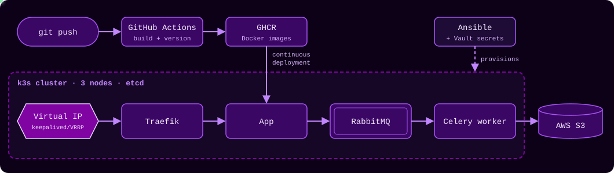

<!-- Header wave -->
<p align="center">
  
</p>

<!-- Typing animation -->
<p align="center">
  <a href="https://github.com/J33r0">
    
  </a>
</p>

<p align="center">
  <a href="https://www.linkedin.com/in/jer%C3%B3nimo-herdo%C3%ADza-fustillos-581b09259/"></a>
  <a href="mailto:jeronimoherdoiza03@gmail.com"></a>
  
  
</p>

---

```console
$ kubectl describe engineer jeronimo
Name:          Jerónimo Herdoíza Fustillos
Namespace:     university-of-strasbourg/cmi-isr
Status:        Running ✅  (Master 2 SIRIS - Networks, Internet & Systems)
Focus:         DevOps · Cloud · SRE · Networks · Security
Languages:     🇫🇷 French · 🇬🇧 English · 🇪🇨 Spanish (native)
Looking-for:   6-month end-of-studies internship, from February 2027
Mobility:      anywhere in France 🚄
Events:
  Normal  Learning      Always            curiosity-controller   Breaking things to understand them
  Normal  Coaching      Weekly            volleyball-team        Coach of my faculty's team 🏐
  Normal  Volunteering  Whenever I can    GirlsCanCode!          Helping participants with their code 👩‍💻
```

## 🛠️ Toolbox

<p align="center">
  
  <br/>
  
</p>

| ☁️ Cloud & Containers                                                         | 🔁 CI/CD & IaC                                                        | 🌐 Networks & Observability                                                 |
| ----------------------------------------------------------------------------- | --------------------------------------------------------------------- | --------------------------------------------------------------------------- |
| Kubernetes (k3s), Docker, Docker Compose, OpenStack, AWS S3, RabbitMQ, Celery | GitHub Actions, GitLab CI/CD, GHCR, Ansible, Ansible Vault, Terraform | TCP/IP, BGP, OSPF, IS-IS, 5G, Traefik, keepalived/VRRP, Prometheus, Grafana |

---

## 🚀 Featured work

### 🧱 [Highly available Kubernetes cluster (k3s)](https://github.com/J33r0/projet-cloud-virt) - _built from scratch_

Three VMs, one distributed app, provisioned and deployed automatically. Provisioned with **Ansible**, secrets encrypted with **Ansible Vault** and served as **Kubernetes Secrets**, exposed through **keepalived/VRRP** and **Traefik**, shipped by a **GitHub Actions → GHCR** pipeline.

<p align="center">
  
</p>

<details>
<summary><b>The part I enjoyed most: killing the primary node on purpose</b> (click me)</summary>
<br/>

<p align="center">
  
</p>

Before the cluster, everything ran locally first: **Docker Compose**, then **k3s on my laptop**, then the real thing.

</details>

### 📡 IoT, Cloud & Observability platform - _Master's project (ongoing)_

I own the **SRE, Cloud and infrastructure** layer: **OpenStack** provisioned with **Terraform** (VMs, public/private networks, security groups), physical and cloud clusters linked through a **WireGuard** tunnel, services on **Kubernetes**, a **GitLab CI/CD** pipeline (IaC, build, tests, deploy) and **Prometheus + Grafana** for observability.

### 📄 [Resume-automation](https://github.com/J33r0/Resume-automation) - _CV-as-code_

My CV is a repo. On every push, **GitHub Actions** detects changes to the French and English versions, recompiles the PDFs with **headless Chrome** and publishes them. Yes, even my resume has a pipeline. 🤖

---

## 🧪 Experience

<details>
<summary><b>🔬 CNRS × University of Strasbourg - Research intern, 5G / Orchestration</b> · May–Jul 2026</summary>

- Dockerized a **5G traffic generator** and automated its deployment on the **POWDER** testbed.
- Wrote a **Bash** runner driven by **YAML** configs (IP resolution, log collection) with a **Python** orchestration backend and web UI.
- Automated remote pipeline execution and metric collection: no more manual steps in the workflow.
</details>

<details>
<summary><b>🌐 CNRS × University of Strasbourg - Research intern, Networking (BGP)</b> · Jun–Jul 2025</summary>

- Automated **BGP** configuration with an **Ansible** playbook.
- Built an interactive debugging tool (**Python + D3.js**) to diagnose routing anomalies faster.
</details>

<details>
<summary><b>⚡ TER - Speeding up LLMs on mobile</b> · Feb–May 2026</summary>

- Up to **+30%** performance vs OpenMP running language models (Qwen, Llama) on a tablet, with a thread scheduler written in **C**.
</details>

## 🏆 Achievements

- 🥇 **1st prize, Capture The Flag (UDLA, Quito)** · Feb 2021: captain of a 3-person team, exploiting system and web vulnerabilities.

---

## 📊 GitHub activity

<p align="center">
  
</p>

## 🧗 When I'm not in a terminal

`🧗 climbing` · `🏐 volleyball coaching` · `🏋️ weightlifting` · `🥾 hiking` · `🧵 sewing` · `🎸 self-taught guitar`

<p align="center">
  
</p>
